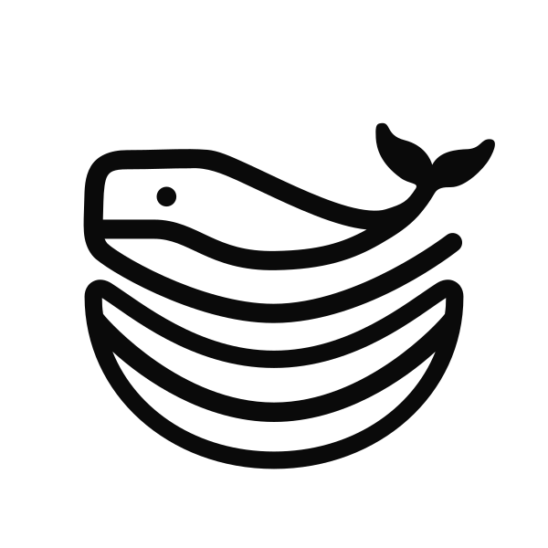
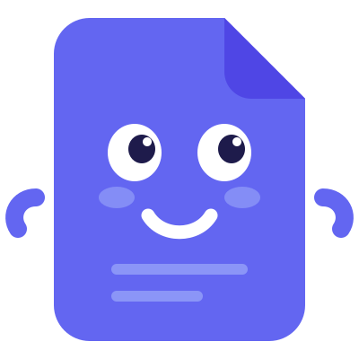
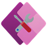

<h1>Hey, I'm Dany </h1>

  
  
  
  
  

<table align="center">
  <tr>
    <td valign="top"></td>
    <td valign="top"></td>
  </tr>
</table>

<h2> About me</h2>

<h2> Journey</h2>

<table align="center">
  <tr>
    <td align="center" width="200"> <b>2021</b> Apprentice developer  Web fundamentals Windows tools in C#</td>
    <td align="center" width="200"> <b>2023</b> Junior developer  React first client projects</td>
    <td align="center" width="200"> <b>2025</b> Fullstack developer  Architecture Docker, Dokploy, CI</td>
    <td align="center" width="200"> <b>2026</b> Freelance  <a href="https://danbenba.dev">danbenba.dev</a> web, SaaS, UI/UX</td>
  </tr>
</table>

<b>How I work</b> &nbsp;·&nbsp; Talk → Design → Build → Ship

<h2> Featured projects</h2>

<table align="center">
  <tr>
    <td align="center" width="420" valign="top">
       
      <a href="https://github.com/danbenba/dokploy-mcp"><b>Dokploy MCP</b></a>  
      Open-source MCP server for <b>Dokploy</b>: let Claude, ChatGPT or any MCP client run your self-hosted panel. Hosted at <a href="https://dokploy.rest">dokploy.rest</a>  
       
    </td>
    <td align="center" width="420" valign="top">
       
      <a href="https://github.com/danbenba/FramerExport"><b>FramerExport</b></a>  
      Export your <b>Framer</b> website to native HTML, ready to host anywhere you like. My most-starred repo.  
       
    </td>
  </tr>
  <tr>
    <td align="center" width="420" valign="top">
       
      <a href="https://github.com/danbenba/skillforge"><b>SkillForge</b></a>  
      A <b>package manager for Claude Agent Skills</b>. Remote connector on claude.ai, local MCP server and CLI for Claude Code.  
       
    </td>
    <td align="center" width="420" valign="top">
       
      <a href="https://fakturapp.cc"><b>Faktur</b></a>  
      A complete <b>invoicing</b> platform: dashboard, API, docs, developer platform, desktop and mobile apps. <a href="https://github.com/fakturapp">@fakturapp</a>  
       
    </td>
  </tr>
  <tr>
    <td align="center" width="420" valign="top">
       
      <a href="https://github.com/danbenba/GPTExporter"><b>GPT Exporter</b></a>  
      Chrome extension that exports your chats from <b>ChatGPT, Claude, Grok, Gemini, Perplexity</b> to Markdown, HTML, JSON, TXT or PDF.  
       
    </td>
    <td align="center" width="420" valign="top">
       
      <a href="https://github.com/danbenba/OmniTools"><b>OmniTools</b></a>  
      Where it all started: a suite of <b>Windows utilities</b> (debloater, tweaks, drivers, Office installer…) to run all kinds of scripts in one click.  
       
    </td>
  </tr>
</table>

<h2> Tech stack</h2>

<b>Frontend</b>

  

<b>Backend & infra</b>

  

<b>Design & tools</b>

  

<h2> Activity</h2>

ASCII portrait, neofetch card and heatmap are animated SVGs generated by <code>scripts/generate.py</code> and refreshed daily by a GitHub Action.

<h2> Let's work together</h2>

  Got a website, a SaaS or a platform to launch? 
  Drop me a line at <a href="mailto:contact@danbenba.dev"><b>contact@danbenba.dev</b></a> or visit <a href="https://danbenba.dev"><b>danbenba.dev</b></a>

 

